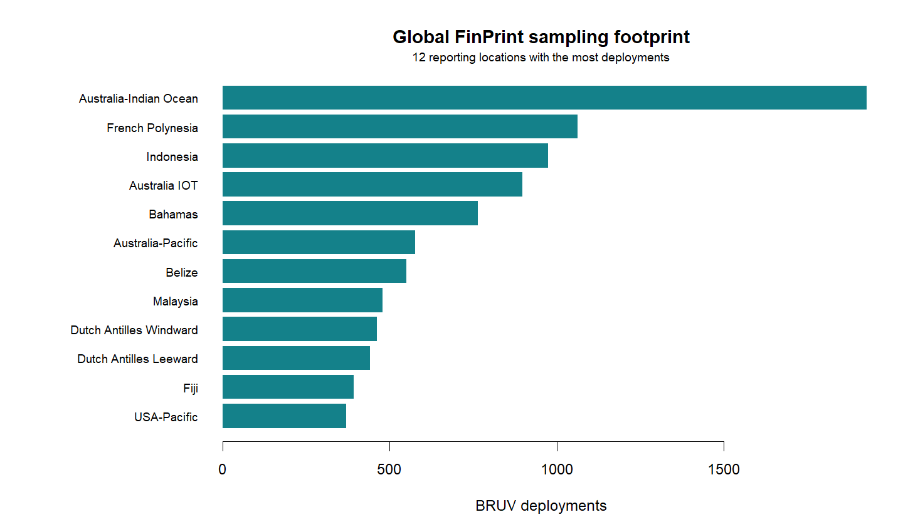
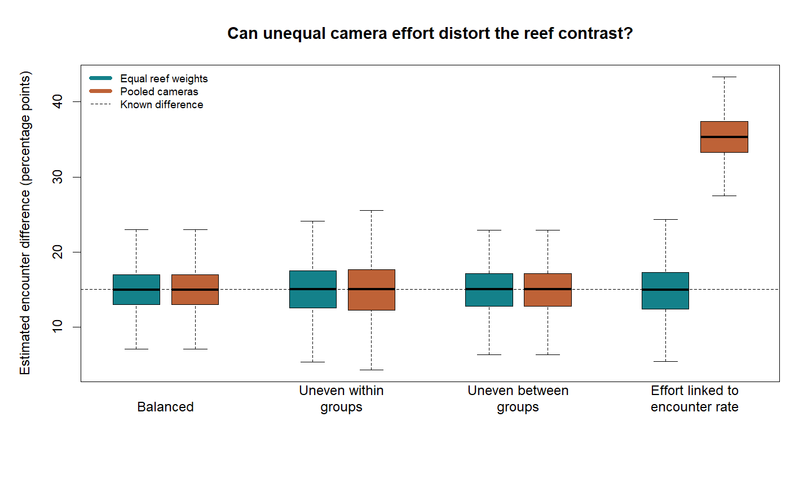
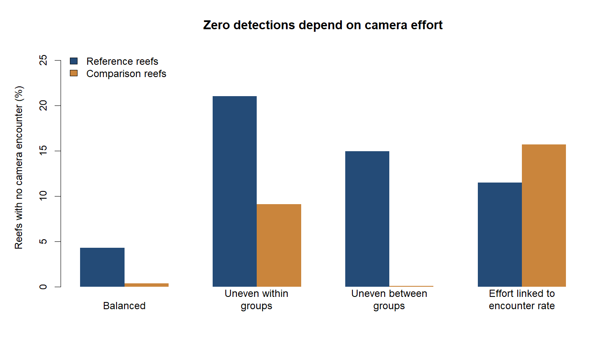

# Global FinPrint reef sharks
## Reproducing MacNeil et al. (2020) and testing uneven BRUV effort

This base-R project reconstructs published survey totals and model comparison results from the authors' archived exports. It then tests whether an uneven allocation of baited remote underwater video (BRUV) deployments can distort a known difference in shark encounter probability.

### Published results

- The monthly counts and reef registry reproduce **15,165 deployments, 371 reefs, and 58 reporting locations**.
- The archived PSIS-LOO comparison assigns the full zero-inflated negative binomial model **77.06%** of the model weight and the version with national covariates in the count component only **16.12%**. These agree with the reported 77% and 16%. This step reconstructs the table from the authors' saved comparison output. It does not refit the Bayesian models or recalculate leave-one-out scores.
- The archive check identifies a discrepancy. The authors' plotting notebook exports the fraction of reefs **with** shark encounters, even though the field is named `Mean_P(no_sharks)`. Converting that fraction back to integer counts gives **299 of 371** reefs with a recorded shark and **72** without one. The paper reports **69** without. The archived tables cannot establish the reason for the three-reef difference, and the analysis preserves both values.



### Simulation findings

The true difference was **15 percentage points** in per-deployment encounter probability between two groups of 60 reefs. All scenarios used 4,800 deployments and shared underlying simulated reef probabilities and potential encounters within each replicate.

| Effort allocation | Equal weight per reef | Pooled cameras |
| --- | ---: | ---: |
| 40 deployments on every reef | 14.97 pp | 14.97 pp |
| Randomly assigned 5 or 75 within both groups | 14.99 pp | 14.97 pp |
| 15 on each reference reef and 65 on each comparison reef | 14.92 pp | 14.92 pp |
| Effort tied to the underlying encounter rate | 14.93 pp | 35.33 pp |

Table entries are averages over 1,000 simulated surveys per scenario. Randomly uneven allocation mostly reduced precision. In the deliberately informative allocation, high-effort cameras went to lower-probability reefs in the reference group and higher-probability reefs in the comparison group. This stress test overstates the difference when cameras are pooled. It is an illustration, and does not imply the original FinPrint surveys used such a design.



In the simulation, increasing or decreasing camera effort also changed the fraction of reefs with no detections. These values describe what the cameras recorded, with no simulated structurally absent reefs.



### Methods

Each simulated reef had its own beta-distributed encounter probability, with group means of 0.20 and 0.35 and beta concentration eight. Deployments were Bernoulli draws conditional on the reef's probability. The comparison is the difference in **average reef-level encounter probability**. Equal reef weighting averages within-reef encounter fractions. Pooling weights those fractions by the number of deployments. With informative effort, the pooled estimator targets a camera-weighted quantity, so its nominal 95% interval is not expected to cover the reef-weighted truth. Intervals use reef-level variance estimates and a t critical value with 59 degrees of freedom. Outputs include bias, RMSE, coverage, and interval width. Simulated outcomes are encounter records rather than occupancy or abundance estimates.

### Run in RStudio

Open [macneil-finprint.Rproj](macneil-finprint.Rproj). The project runs offline in base R.

```r
source("run.R")         # Rebuild all results and PNGs
source("show-plots.R")  # Draw all three charts in the Plots pane
```

| File | Contents |
| --- | --- |
| [results/reproduction.csv](results/reproduction.csv) | Archived totals alongside the published values |
| [results/model-weights.csv](results/model-weights.csv) | Reconstructed PSIS-LOO model comparison |
| [results/archived-encounters-by-location.csv](results/archived-encounters-by-location.csv) | Audit of positive and zero-encounter reef counts |
| [results/simulation-summary.csv](results/simulation-summary.csv) | Performance by sampling design and estimator |
| [results/simulation-replicates.csv](results/simulation-replicates.csv) | 8,000 estimates across scenarios and estimators |

### Data and citations

The bundled inputs are the authors' [monthly effort export](https://github.com/mamacneil/FinPrint/blob/master/Sampling_summaries.csv), [reef registry](https://github.com/mamacneil/FinPrint/blob/master/ReefCheck.csv), [location-level encounter export](https://github.com/mamacneil/FinPrint/blob/master/Mean_ReefAbsence.csv), and [model comparison export](https://github.com/mamacneil/FinPrint/blob/master/ModelCompLoo.csv). The inputs are unmodified and their hashes are listed in [data/SHA256.txt](data/SHA256.txt). The public project used the authors' notebook to verify how the encounter summary was constructed. [CC0 archive](https://github.com/mamacneil/FinPrint) · [Authors' plotting notebook](https://github.com/mamacneil/FinPrint/blob/master/FinPrint_Plots.ipynb)

MacNeil, M. A., Chapman, D. D., Heupel, M., et al. (2020). Global status and conservation potential of reef sharks. *Nature, 583*, 801–806. [Paper](https://doi.org/10.1038/s41586-020-2519-y) · [Author correction](https://doi.org/10.1038/s41586-020-2692-z)
